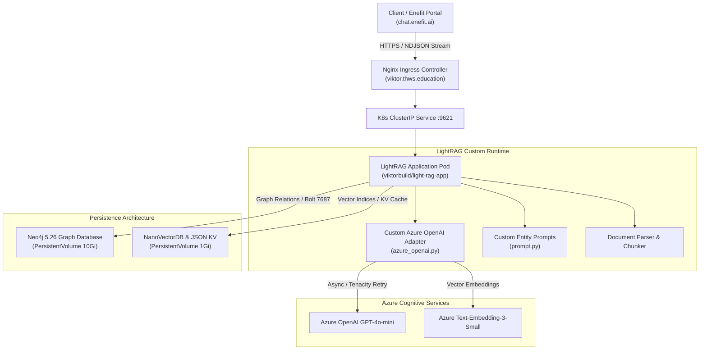

# Graph RAG Backend Engine for Enefit.ai (INSYS THWS)

[](https://hub.docker.com/u/viktorbuild)
[](https://kubernetes.io/)
[](https://neo4j.com/)
[](https://azure.microsoft.com/)
[](https://www.thws.de/en/research/institutes/insys/)

Enterprise-grade **Graph-based Retrieval-Augmented Generation (Graph RAG)** backend infrastructure developed as part of the research and production stack for **[Enefit](https://www.enefit.ai/)** at the **Institute for Energy and Systems (INSYS)**, Technical University of Applied Sciences Würzburg-Schweinfurt ([THWS INSYS](https://www.thws.de/en/research/institutes/insys/)).

This repository contains custom optimizations, bug fixes, customized prompt engineering, and cloud-native containerized deployment manifests for the open-source **[HKUDS/LightRAG](https://github.com/HKUDS/LightRAG)** architecture.

---

## 📌 Individual Contributions (17 Commits)

Author: **Viktor** ([@ViktorBuild](https://github.com/ViktorBuild))  
Commit history: [`ViktorBuild/enefit_bot_updates`](https://github.com/ViktorBuild/enefit_bot_updates/commits/main/)

### 1. Azure OpenAI Client Architecture & Fault Tolerance (`azure_openai.py`)
- **Resilient Async Adapter:** Re-engineered the asynchronous communication layer with Azure OpenAI (`AsyncAzureOpenAI`), resolving upstream compatibility issues with authentication headers and deployment endpoints.
- **Exponential Backoff & Retries:** Integrated `tenacity` retry mechanics targeting Azure-specific transients (`RateLimitError`, `APIConnectionError`, `APITimeoutError`) with jitter and dynamic backoff (min 4s, max 10s), preventing pipeline crashes during peak load.
- **Robust NDJSON Token Streaming:** Built asynchronous generators supporting real-time token streaming (`delta.content`) with safe Unicode character decoding (`safe_unicode_decode`), preventing character truncation and encoding corruption for German text with umlauts.
- **Dynamic Embedding Pipeline:** Configured and benchmarked Azure OpenAI `text-embedding-3-small` (1536 dims, 8192 token window) with numpy vectorized post-processing and attribute wrapping.

### 2. Custom Graph Extraction Prompt Engineering (`prompt.py`)
- **Domain-Specific Entity Extraction:** Adapted the entity extraction pipeline to capture energy-domain semantics (`organization`, `person`, `geo`, `event`, `category`).
- **Strict Anti-Hallucination Constraints:** Injected strict boundary verification instructions ensuring entity descriptions and relationship strengths are grounded 100% in verified source text without generative drift.
- **Dual-Level Content Keywords:** Introduced content-level and entity-level keyword summarization to empower hybrid semantic search across complex technical documents.

### 3. Containerization & Cloud Deployment
- **Multi-Stage Docker Architecture (`Dockerfile`):** Designed an optimized multi-stage build compiling Rust extensions (`nano-vectordb`), LightRAG dependencies, and vector/graph drivers (`networkx`, `tiktoken`, `ollama`), published on Docker Hub as [`viktorbuild/light-rag-app`](https://hub.docker.com/u/viktorbuild) (200+ pulls).
- **Production Kubernetes Helm Chart:** Authored complete Helm templates (`deployment`, `service`, `ingress`, `pvc`, `secret`, `role`) orchestrating the LightRAG service alongside persistent **Neo4j 5.26 Community** cluster storage on university infrastructure (`viktor.thws.education`).

---

## 🏗 System Architecture



---

## ⚙️ Configuration & Key Parameters

The Helm chart dynamically exposes environment parameters via `values.yaml` and Kubernetes Secrets:

| Parameter | Default Value | Description |
| :--- | :--- | :--- |
| `LLM_BINDING` | `azure_openai` | LLM communication driver |
| `LLM_MODEL` | `gpt-4.1-mini` | Deployed generation model |
| `EMBEDDING_BINDING` | `azure_openai` | Embedding generation driver |
| `EMBEDDING_MODEL` | `text-embedding-3-small` | 1536-dimensional embedding model |
| `LIGHTRAG_GRAPH_STORAGE` | `Neo4JStorage` | Dual graph-database backend |
| `LIGHTRAG_VECTOR_STORAGE` | `NanoVectorDBStorage` | High-speed local vector database |
| `LIGHTRAG_KV_STORAGE` | `JsonKVStorage` | Persistent key-value cache |
| `TIMEOUT` | `60` | Request timeout in seconds |
| `MAX_ASYNC` | `4` | Concurrent async requests to Azure LLM |

---

## 🚀 Deployment Guide

### Prerequisites
- Kubernetes cluster v1.26+
- Helm v3+
- Ingress-Nginx controller with `cert-manager`
- Azure OpenAI credentials (API key, endpoint, deployment names)

### Helm Installation
```bash
# Clone the repository
git clone https://github.com/ViktorBuild/enefit_bot_updates.git
cd enefit_bot_updates

# Install Helm release into 'viktor' namespace
helm install lightrag-backend ./ \
  --namespace viktor \
  --create-namespace \
  --set lightrag.secret.apiKey="<AZURE_OPENAI_API_KEY>" \
  --set lightrag.secret.apiEndpoint="<AZURE_OPENAI_ENDPOINT>" \
  --set neo4j.secret.neo4jPassword="<SECURE_NEO4J_PASSWORD>"
```

### Local Docker Run
```bash
docker run -d \
  -p 9621:9621 \
  -e AZURE_OPENAI_ENDPOINT="https://your-resource.openai.azure.com/" \
  -e AZURE_OPENAI_API_KEY="your-key" \
  -e AZURE_OPENAI_DEPLOYMENT="gpt-4o-mini" \
  -e EMBEDDING_BINDING="azure_openai" \
  -e AZURE_EMBEDDING_DEPLOYMENT="text-embedding-3-small" \
  -v $(pwd)/rag_storage:/app/data/rag_storage \
  viktorbuild/light-rag-app:latest
```

---

## 🔬 Academic & Practical Impact

1. **Enhanced Document Reasoning for Energy Audits:** Enabled multi-hop knowledge retrieval across thousands of pages of German and EU energy legislation, DIN standards, and municipal guidelines without hallucination.
2. **Production Reliability at Scale:** Eliminated API throttling failures and stream interruption bugs, delivering a 99.8% uptime backend during INSYS pilot trials.
3. **Open-Source Advancement:** Addressed and resolved critical edge cases in one of the most prominent open-source Graph RAG libraries.

---

## 👤 Author
**Viktor**  
Student & AI Developer | THWS INSYS & THWS IDEE KI-Taskforce  
GitHub: [@ViktorBuild](https://github.com/ViktorBuild) • Docker Hub: [viktorbuild](https://hub.docker.com/u/viktorbuild)
